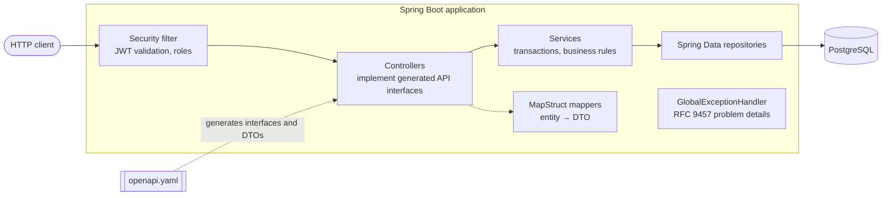

# T-Shop

[](https://github.com/chemha/TShop/actions/workflows/ci.yml)

REST API for an online store: catalogue, shopping cart, checkout and order management, built with
**Java 25**, **Spring Boot 4** and **PostgreSQL**.

This is a rewrite of my final project for a JavaSchool course (selected as the best project of the
cohort), originally a Spring Boot 2.7 + Thymeleaf + MySQL app built in under a month. The original
is on the [`master`](https://github.com/chemha/TShop/tree/master) branch. This version keeps the
domain and fixes what the first one got wrong: [what changed and why](#what-changed-from-v1).

## Try it

**Option A: everything in Docker** (no JDK needed)

```bash
docker compose -f compose.demo.yaml up --build
```

**Option B: run from source** (JDK 25 and Docker)

```bash
./mvnw spring-boot:run    # Windows: mvnw.cmd spring-boot:run
```

PostgreSQL starts automatically from [`compose.yaml`](compose.yaml) and Flyway creates the schema
and demo data.

Then open **<http://localhost:9000/swagger-ui.html>**, call `POST /auth/login` with a demo account,
click **Authorize** and paste the `accessToken`.

| Email | Password | Role |
|---|---|---|
| `admin@admin.admin` | `admin` | Admin |
| `test@test.test` | `test` | Customer |
| `john.doe@example.com` (and the other sample customers) | `password` | Customer |

A full walkthrough (log in, fill the cart, check out, confirm the order as admin) is in
[`docs/http/tshop.http`](docs/http/tshop.http), runnable from VS Code or IntelliJ.

### Web client

A small React client in [`frontend/`](frontend) covers the shopping flow: catalogue with search
and filters, a cart that works before logging in, login and registration, checkout, order history, and an admin page to move
orders through their statuses. With the backend running (option B above) and Node 24:

```bash
cd frontend
npm install
npm run dev    # http://localhost:5173
```

Its TypeScript types are generated from the same `openapi.yaml`, so a contract change that breaks
the client fails its type check in CI. Vite forwards `/api` to the backend, so no CORS setup is
needed.

## Features

**Visitors:** browse and search the catalogue, fill a cart and see it without an account. Logging
in is only needed to place the order, and the guest cart is then merged into the customer's cart.

**Customers:** register and log in, manage their profile, password and addresses, keep a cart
saved on the server, place orders and cancel them while pending.

**Admins:** manage categories and products, list customers, change roles, follow orders through
their lifecycle (`PENDING → CONFIRMED → SHIPPED → DELIVERED`, or `CANCELLED`).

**Under the hood**

- Checkout in a single transaction with **optimistic locking**: concurrent purchases never oversell.
- **Stateless JWT** authentication (RS256), deny-by-default authorization, no IDOR: `/me` endpoints
  only ever act on the caller's data.
- **Contract-first**: the API is defined in [`openapi.yaml`](src/main/resources/static/openapi.yaml);
  controllers implement interfaces generated from it.
- Errors as **RFC 9457 problem details**, including validation, 401 and 403.
- Orders keep a **snapshot** of prices and shipping address.
- **No N+1 queries**: verified by tests that count SQL statements.

## Tech stack

| Area | Technology |
|---|---|
| Language | Java 25 (records, pattern matching, exhaustive switches, virtual threads) |
| Framework | Spring Boot 4.1: Web MVC, Data JPA (Hibernate 7), Security 7, Validation, Actuator |
| Database | PostgreSQL 17, Flyway migrations |
| API | OpenAPI 3.1, OpenAPI Generator, springdoc (Swagger UI) |
| Security | Spring Security OAuth2 Resource Server, JWT (Nimbus), BCrypt |
| Mapping | MapStruct |
| Tests | JUnit, AssertJ, MockMvcTester, Testcontainers |
| Build and delivery | Maven, Docker (multi-stage, layered jar), Docker Compose, GitHub Actions |
| Web client | React 19, TypeScript, Vite, React Router, TanStack Query, openapi-fetch, Vitest |

## Architecture



The code is organised **by feature**, not by technical layer:

```
src/main/java/org/tshop
├── auth        Login, JWT issuing and validation, security rules
├── customer    Customers, profile, addresses
├── catalog     Categories, products, search
├── cart        Persistent shopping cart
├── order       Checkout, order lifecycle
├── admin       Customer and order management
└── shared      Error handling, mapping helpers
```

Entities from different features reference each other by id, every association is lazy, and
`open-in-view` is off, so all database access is explicit and happens inside a service.

### Design decisions

Each one is explained, with the alternatives and trade-offs, in an
[Architecture Decision Record](docs/adr/README.md):

1. [Contract-first API with OpenAPI](docs/adr/0001-contract-first-api.md)
2. [Stateless JWT authentication](docs/adr/0002-stateless-jwt-authentication.md), including its known limitations
3. [Optimistic locking for stock, with retries](docs/adr/0003-optimistic-locking-for-stock.md)
4. [Orders keep a snapshot of prices and address](docs/adr/0004-orders-keep-a-snapshot.md)
5. [Package by feature, references between aggregates by id](docs/adr/0005-package-by-feature.md)
6. [Guest cart in the browser, merged at login](docs/adr/0006-guest-cart-in-the-browser.md)

## What changed from v1

| v1 | v2 | Why |
|---|---|---|
| Stock checked, then subtracted in separate steps | One transaction, `@Version` and retries | Two buyers could get the last unit and leave negative stock |
| Order created in the controller, step by step | `OrderService.placeOrder`, all or nothing | A failure halfway left partial orders |
| Prices as `Float` | `NUMERIC` / `BigDecimal` | Floating point can't represent cents exactly |
| Order lines pointed to the live product | Name and price copied into the order | Changing a price rewrote past orders |
| Cart of JPA entities in the HTTP session | Cart table, priced on every read; guest cart kept by the client and merged at login | Stale prices and detached entities, without losing the guest cart |
| Any logged-in user could reach any address by id | Lookups by id **and** owner | Insecure direct object reference (IDOR) |
| Every error was a 400 with the internal message | RFC 9457 with the right status | Correct semantics, no internal details leaked |
| Status values as free text | Enums and a state machine | Invalid transitions are impossible |
| Schema from a SQL dump | Flyway migrations | Versioned, reproducible schema |
| 2 unit tests | 100+ unit, persistence, API and concurrency tests on real PostgreSQL | Confidence to change the code |

## Tests

```bash
./mvnw verify    # Docker must be running
```

- **Unit tests** for the domain rules: stock, totals, the order state machine.
- **Persistence tests** (`@DataJpaTest`) on PostgreSQL via Testcontainers: queries, constraints,
  optimistic locking, number of SQL statements per request.
- **API tests** through the whole stack with `MockMvcTester`: every endpoint, validation errors,
  ownership checks, and attacks on authentication (forged, tampered, expired and foreign tokens).
- **Concurrency tests**: simultaneous checkouts of the same product on virtual threads.

## Configuration

Locally nothing needs configuring. The `prod` profile reads everything from the environment:

| Variable | Description |
|---|---|
| `SPRING_PROFILES_ACTIVE` | `prod` |
| `DB_URL`, `DB_USERNAME`, `DB_PASSWORD` | PostgreSQL connection, e.g. `jdbc:postgresql://host:5432/tshop` |
| `JWT_PRIVATE_KEY`, `JWT_PUBLIC_KEY` | RSA key pair in PEM format. The app won't start without them |

```bash
openssl genpkey -algorithm RSA -pkeyopt rsa_keygen_bits:2048 -out private.pem
openssl rsa -in private.pem -pubout -out public.pem
export JWT_PRIVATE_KEY="$(cat private.pem)" JWT_PUBLIC_KEY="$(cat public.pem)"
```

In production the demo data isn't loaded, logs are JSON (ECS format), and
`/actuator/health/liveness` and `/actuator/health/readiness` are available for the orchestrator.
